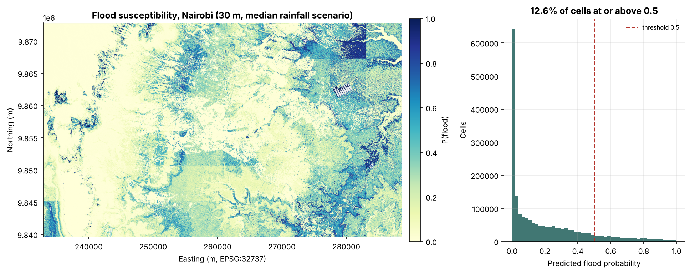
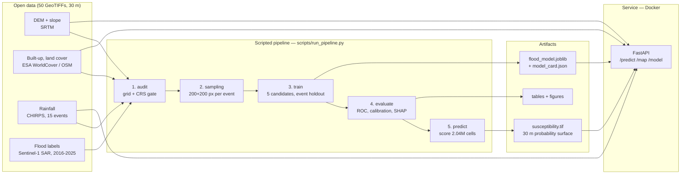

# Urban Flood Susceptibility for Nairobi

An end-to-end machine-learning system that estimates, for every 30 m pixel in Nairobi
City County, the probability that it floods during a heavy-rainfall event. It ships as a
scripted pipeline (raw GeoTIFFs in, trained model and susceptibility raster out) and a
containerised prediction API.

**DSA 8401 Applied Machine Learning — Capstone**
Esther Onyando · MSc Data Science & Analytics, Strathmore University

---

## Results

Trained on 11 flood events, scored on **4 events the model never saw**:

| Model | ROC AUC | F1 | Precision | Recall | Brier | Fit time |
|---|---|---|---|---|---|---|
| Stacking ensemble | 0.9068 | 0.7903 | 0.8614 | 0.7300 | 0.1317 | 4.73 s |
| **XGBoost → deployed** | **0.9058** | **0.7936** | **0.8522** | **0.7425** | **0.1304** | **0.11 s** |
| Random forest | 0.8999 | 0.7731 | 0.8558 | 0.7050 | 0.1313 | 0.63 s |
| Average ensemble | 0.8940 | 0.7845 | 0.8444 | 0.7325 | 0.1341 | 0.76 s |
| Logistic regression | 0.7899 | 0.6882 | 0.6395 | 0.7450 | 0.1931 | 0.01 s |

The stacking ensemble scores highest, and is **not** the model that gets deployed. Its
margin over XGBoost is 0.001 ROC AUC on 1,600 test rows — well inside run-to-run noise —
for 43× the fit time and a meta-model that is harder to explain to a regulator. The
pipeline therefore selects the *simplest model within a tolerance of the best*
(`selection.tolerance` in `config.yaml`), and records why in `models/model_card.json`.



---

## Architecture



The API reads the rasters directly, not just the precomputed surface, so a point query is
scored from the live predictor stack under any observed rainfall scenario rather than
looked up from a cached image. It will not accept invented rainfall values — see
[What the model actually learned](#what-the-model-actually-learned).

---

## Quickstart

### The short way

```
START_HERE.bat          Windows - double-click it
./start_here.sh         macOS / Linux
```

One command from a fresh copy to a working app: it checks the interpreter,
creates `.venv`, installs both requirement sets, finds and extracts the 50
rasters from the data archive, trains the model if there isn't one, then starts
the API and opens the app in your browser. It stops with a plain explanation if
any step can't be done. `python scripts/bootstrap.py --help` lists the flags
(`--data-zip`, `--no-venv`, `--no-ui`, `--port`).

The rest of this section is the same thing done by hand.

### Continuous integration

GitHub Actions runs the full test suite, validates Compose configuration, and builds both
containers on pushes and pull requests. The prepared raster derivatives in
`data/nairobi_flood_data/` are versioned with source acknowledgement in
[`data/README.md`](data/README.md), so a clean clone exercises the same data contract as
the deployed service.

### Render deployment

[`render.yaml`](render.yaml) defines two Docker web services in Frankfurt: the
FastAPI model service and this repository's Streamlit dashboard. Render deploys only
after the GitHub Actions checks pass (`autoDeployTrigger: checksPass`), so GitHub Actions
provides CI and Render provides CD from `main`.

The dashboard receives the API's Render-managed public URL as `FLOOD_API_URL`; no URL or
credential is committed. Both services use Render's assigned `PORT` in deployment while
preserving the local Compose ports (8000 and 8501).

**Deployment data decision required.** The deployed API reads the 50 prepared GeoTIFFs
in `data/nairobi_flood_data/` for every live point prediction. The prepared derivatives
are included with their source acknowledgement and reuse notes in
[`data/README.md`](data/README.md). Do not replace the raster lookup with the precomputed
map: that would change the advertised API behaviour.

### 1. Install

```bash
python -m venv .venv && source .venv/bin/activate     # Windows: .venv\Scripts\activate
pip install -r requirements.txt
```

Python **3.13** is required. The pinned `rasterio`, `pyproj`, `xgboost`, `shap` and
`numpy` publish no wheels for 3.11 or 3.12, so an older interpreter will try to compile
them from source.

### 2. Run the pipeline

```bash
python scripts/run_pipeline.py
```

About 15 seconds end to end on a laptop CPU. It audits the rasters, draws the sample,
trains all five candidates, writes the diagnostics, and scores all 2.04 million cells.
Every stage is seeded (`seed: 42`), so a rerun reproduces the tables above exactly.

```
python scripts/run_pipeline.py --skip-predict          # stop before the raster sweep
python scripts/run_pipeline.py --scenario E14_2025_04  # map a specific storm
```

### 3. Serve

```bash
uvicorn floodrisk.api:app --reload --app-dir src
# or
docker compose up --build
```

Then open <http://localhost:8000/docs> for the interactive API browser.

```bash
curl -X POST http://localhost:8000/predict \
  -H 'content-type: application/json' \
  -d '{"points":[{"lat":-1.2630,"lon":36.8600}],"scenario":"median"}'
```

Or exercise the whole service end to end:

```bash
python scripts/demo_predictions.py        # real HTTP calls, writes outputs/tables/api_demo.csv
```

An optional Streamlit UI renders what the API returns (it holds no model of its own):

```bash
docker compose --profile ui up --build    # UI on :8501, API on :8000
```

```json
{
  "scenario": "median",
  "model_name": "xgboost",
  "threshold": 0.5,
  "predictions": [{
    "lat": -1.263, "lon": 36.86,
    "status": "ok", "probability": 0.113, "risk_band": "low",
    "permanent_water": false,
    "features": {"dem": 1600.0, "slope": 2.1, "builtup": 1.0, "rain7": 50.2, "rain_sum": 121.4}
  }]
}
```

### 4. Test

```bash
pytest                                  # 41 tests, ~8 s
python scripts/check_split_leakage.py   # what the event split is protecting against
```

[`VALIDATION.md`](VALIDATION.md) is a runnable acceptance checklist: nine checks,
each with the command, the expected output, and what a failure would mean —
including a section on what this system does **not** validate.

---

## API

| Method | Route | Purpose |
|---|---|---|
| `GET` | `/health` | Liveness, and whether the model is loaded |
| `GET` | `/model` | Model card: features, training events, held-out scores, selection rationale |
| `GET` | `/extent` | The geographic box the model is valid over |
| `GET` | `/scenarios` | Rainfall scenarios available (`median`, `max`, or any of the 15 events) |
| `POST` | `/predict` | Flood probability at up to 1,000 points, under a named rainfall scenario |
| `GET` | `/map` | Download the 30 m susceptibility GeoTIFF |

`/predict` accepts a `scenario` (`median`, `max`, or any of the 15 event ids) but **not**
arbitrary `rain7` / `rain_sum` values — those are rejected with HTTP 422. The model's
rainfall response is not monotonic, so a free-form what-if would be confidently wrong.

Points outside the raster extent return `status: "outside_extent"` with a null
probability. The service will not extrapolate beyond the area it was trained on.

---

## Getting the data

The pipeline expects 50 co-registered GeoTIFFs in `data/nairobi_flood_data/`:

```
dem_srtm_30m_nairobi.tif              slope_deg_30m_nairobi.tif
builtup_mask_worldcover_30m_nairobi.tif  landcover_worldcover_30m_nairobi.tif
perm_water_mask_occ30_nairobi.tif

label_event_water_E01_2016_04.tif     rain7_E01_2016_04.tif     rain_sum_E01_2016_04.tif
...                                   (15 events in total)
```

All layers must share one grid — 1858 × 1108 cells, EPSG:32737, 30 m pixels. The audit
step checks this and stops the run rather than resampling silently, because a half-pixel
offset between a predictor and a label is invisible in the outputs and corrupts every
sample drawn.

Sources: SRTM (terrain), ESA WorldCover (land cover, built-up), OpenStreetMap
(built-up), CHIRPS (rainfall), Sentinel-1 SAR (flood labels).

---

## Repository layout

```
├── START_HERE.bat              one-click setup and launch (Windows)
├── scripts/bootstrap.py        what it runs: install, data, train, serve
├── config.yaml                 every path and parameter, one file
├── scripts/run_pipeline.py     the single entry point
├── src/floodrisk/
│   ├── config.py               configuration and path resolution
│   ├── rasters.py              raster I/O and the co-registration gate
│   ├── audit.py                step 1 — verify before trusting
│   ├── sampling.py             step 2 — event-balanced sample + event split
│   ├── models.py               the five candidates
│   ├── train.py                step 3 — fit, score, select, serialize
│   ├── evaluate.py             step 4 — curves, calibration, importance, SHAP
│   ├── predict.py              step 5 — raster sweep + point scoring
│   └── api.py                  the FastAPI service
├── app/streamlit_app.py        optional UI; renders API output, computes nothing
├── scripts/demo_predictions.py end-to-end client demo against the running service
├── tests/                      41 tests, including the leakage check
├── models/                     flood_model.joblib, model_card.json
├── outputs/figures|tables/     every figure and table in the report
├── notebooks/                  the exploratory notebook this pipeline replaced
├── report/REPORT.md            problem framing, justification, results, limitations
├── VALIDATION.md               how to verify every claim above, with commands
├── Dockerfile, docker-compose.yml
└── AI_USE.md                   disclosure of AI assistance
```

---

## What the model actually learned

Permutation importance on the held-out events, measured as the drop in ROC AUC when a
predictor is shuffled:

| Predictor | Importance |
|---|---|
| `dem` (elevation) | 0.338 |
| `slope` | 0.054 |
| `builtup` | 0.035 |
| `rain_sum` | 0.006 |
| `rain7` | 0.002 |

This is, to be blunt about it, **a terrain model**. Elevation carries almost all the
signal; the two rainfall predictors are nearly inert.

The consequence is concrete rather than academic. Sweeping rainfall from 0 to 1,000 mm
across 500 real pixels, predicted probability rises on only **4 of 8** steps, and
comparing a light storm against a heavy one it *falls* for **282 of 500** pixels. The
model's rainfall response is not monotonic, so the API **rejects arbitrary rainfall
values (HTTP 422)** and serves only rainfall fields actually observed. Every prediction
carries that caveat. Reproduced by the pipeline into
`outputs/tables/rainfall_response.csv`.

See [`report/REPORT.md`](report/REPORT.md#what-the-model-actually-learned) for why, and
what it means for how the map should be read.

---

## Limitations in brief

- Labels are Sentinel-1 water masks, not ground truth. SAR under-detects flooding beneath
  dense urban fabric and the overpass can miss peak extent.
- Training is balanced 50/50 while real prevalence is ~0.08% per event, so the 0.5
  threshold is a presentational default, not a calibrated decision threshold.
- Rainfall enters at CHIRPS's native resolution, which is far coarser than 30 m; its
  footprint is visible as rectangular blocking in the north-east of the map.
- The output is a hazard indicator. It is not a flood-risk map until exposure and
  vulnerability layers are joined to it.

The full treatment is in [`report/REPORT.md`](report/REPORT.md).

---

## License

Academic work submitted for DSA 8401, Strathmore University.
